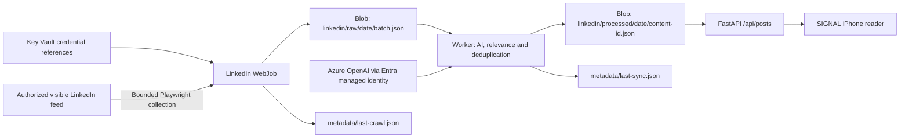

# SIGNAL

A private, iOS-first LinkedIn intelligence reader. Expo / React Native, FastAPI,
and private Azure Blob JSON files. No database, news sources, analytics,
advertising, or social features.

The interface uses Material 3 components from React Native Paper: elevated,
rounded reading cards, tonal filter chips, a search bar, pill navigation and
a floating sync action. A red featured-insight card anchors the Today page,
with lavender/amber reading counters and a topic radar. Red titles and accents
(`#D71920` in light mode, `#FF7373` in dark mode) sit on layered neutral surfaces;
long-form copy uses a quieter, high-contrast foreground. Light/dark and large
reading-text preferences are preserved, and motion respects reduced-motion settings.

Typography bundles SIL Open Font License fonts, Inter for article text and
Manrope for display headings. These are close alternatives, **not** TechCrunch's
commercial NB International Pro and Yellix fonts; exact typography requires
separately licensed web/app font files. SIGNAL retains its own branding,
content and original decorative article illustrations. Font license notices
are included in `frontend/assets/fonts/`.

**Important:** LinkedIn identity sign-in is not home-feed access. SIGNAL imports
official LinkedIn exports and includes an **opt-in background browser worker**.
Standard LinkedIn permissions do not grant network-feed access; the worker is
not an official API integration. Demo posts and authors are explicitly fictional.

For the deployed application, start with the
[end-to-end Azure flow and data inspection runbook](#live-azure-flow-and-data-inspection).

## Project structure

```text
frontend/
  app/
    (tabs)/                 Today, Discover, Topics, Saved, Settings
    post/[id].tsx            Full reader and three-level explanations
  components/               Editorial primitives and article feed
  hooks/useSignal.tsx        Demo/live state, sessions, import and sync
  services/                 Typed API client and reading/filter helpers
  assets/posts.json          Clearly labeled synthetic demo edition
  theme/                    Dark/light palettes and typography
  app.config.ts
  eas.json
  package.json
backend/
  app/
    main.py                 API factory, lifecycle, scheduler, OAuth callback
    api/auth.py             Revocable single-user sessions and login limiter
    config/                 Validated environment configuration
    models/                 Pydantic request/response/AI schemas
    services/
      reader.py             Ingestion, recommendations, bookmarks, retention
      linkedin/             Export adapter and bounded Playwright browser collector
      ai/                   Azure OpenAI and OpenAI structured output
      storage/              Atomic local JSON and Managed Identity Blob storage
    utils/                  Authenticated, size-bounded multipart handling
    worker.py               Single background collection/processing run
  requirements.txt
  requirements-crawler.txt   Optional browser worker dependencies
  startup.sh
infrastructure/             Bicep resources and nonsecret parameter example
deployment/                 Infrastructure, ZIP/container deployment, scheduled WebJob
scripts/                    Local setup, backend packaging, EAS and Drive upload
tests/
  backend/
  frontend/
deploy.sh
build-ios.sh
.env.example
```

The repository root is the application root; no redundant enclosing `signal/`
directory is needed.

## Run locally

Requires Node 22+, Python 3.12 or 3.13, and npm. On Windows use PowerShell for
development; deployment/build `.sh` scripts require Git Bash, WSL, macOS or Linux.

From the repository root:

```powershell
python scripts\setup-local.py
python -m venv backend\.venv
backend\.venv\Scripts\python -m pip install -r backend\requirements.txt
Set-Location backend
.\.venv\Scripts\python -m uvicorn app.main:create_app --factory --host 0.0.0.0 --port 8000
```

In another terminal:

```powershell
Set-Location frontend
npm ci
npm start
# Press i for an iOS simulator (macOS/Xcode required), or scan with Expo Go.
# Web preview:
npm run web
```

On macOS/Linux: `python3 -m venv backend/.venv`, then use
`backend/.venv/bin/python`; inside `backend`, run
`.venv/bin/python -m uvicorn app.main:create_app --factory --host 0.0.0.0`.

The frontend starts with the fictional demo edition and works without an API.
In Settings, enter `SIGNAL_LOGIN_SECRET` from your private `backend/.env` to
connect the live reader. There is no shared/default production password.
An iPhone cannot reach your computer's `localhost`: set
`EXPO_PUBLIC_API_URL=http://<your-computer-LAN-IP>:8000` in `frontend/.env` for
development, or use your HTTPS Azure endpoint. Allow only your private LAN
through your local firewall. Production builds reject non-HTTPS API URLs.

Native session tokens use SecureStore with device-only, unlocked keychain
access. The optional web preview uses sessionStorage, not persistent localStorage.
Demo data is isolated in device AsyncStorage. Live content is never substituted
with sample data on a failed API request. Sign-out revokes the server session.

## LinkedIn connection and authorized export import

1. In LinkedIn, open **Settings & Privacy > Data privacy > Get a copy of your
   data**, request your posts/shares archive, and download it yourself.
2. In SIGNAL Settings, sign into your private backend.
3. Configure an AI provider (below), select **Upload LinkedIn export**, and choose
   `Shares.csv`, `posts.json`, or a ZIP containing those files.
4. Tap **Sync imported posts**. Existing content remains available during sync.
   The sync status is polled until completed or failed; failures retain raw
   content for retry. Large imports can require several syncs.

The importer accepts up to 10 MiB expanded content and 5,000 rows. It never
extracts ZIP members to disk, follows source URLs, or downloads LinkedIn media.
`Shares.csv` uses `ShareCommentary`, optional `ShareLink`, optional `Date`, and
optional `MediaUrl` for a source image. Normalized CSV can instead include
`image_urls` as a JSON-encoded array.
A CSV preamble is supported. Unknown authors, links and publication timestamps
remain missing. A date without a timezone is not assigned an invented timezone.
Original post text is stored separately and unchanged.

An alternate normalized JSON export shape is:

```json
{
  "posts": [
    {
      "original_text": "The original text you are authorized to process.",
      "author": null,
      "author_url": null,
      "url": null,
      "published_at": null,
      "image_urls": []
    }
  ]
}
```

For posts with images, populate `image_urls` with up to 10 direct HTTPS image
links from the authorized source post. URLs with embedded credentials are
rejected. The first image appears on Today, Discover, and Saved cards; the
reader displays every supplied image without cropping. Text-only posts use
clearly labeled original topic artwork, never an invented source photograph.
Loading states, unavailable/expired-link notices, and retry actions are built in.

Image links are preserved in raw records, processed posts, and saved snapshots.
Reimporting the same post with images adds or refreshes its image links without
duplicating the post or rerunning AI analysis; text-only reimports preserve
existing links. The export adapter does not fetch image links or post pages.
The optional browser collector loads LinkedIn normally to extract visible post
text and image links. Neither path sends image URLs to the AI provider.
The device loads images directly from their
source hosts (web requests omit the page referrer), so those hosts can observe
the image request. LinkedIn export ZIP attachments are not extracted or hosted.
Saving a post preserves its links, not a permanent offline copy of remote
images; expired or access-protected URLs may need a fresh authorized export.

Use only authorized LinkedIn content, not copied network-feed material without
permission. A personal export does **not** necessarily include other members'
posts, your home feed, or every saved post.

Optional OAuth identity connection:

- Create a LinkedIn developer application and enable **Sign In with LinkedIn
  using OpenID Connect**. Set client ID/secret only on the backend.
- Register the exact `SIGNAL_LINKEDIN_REDIRECT_URI`, normally
  `https://<app>.azurewebsites.net/api/linkedin/callback`.
- SIGNAL requests `openid profile`, checks a short-lived, single-use state,
  exchanges the authorization code server-side, fetches userinfo, and encrypts
  the access token at rest with a key derived from the independent session secret.
- Return to Settings after authorization. Expired identity tokens show
  disconnected; reconnect rather than assuming indefinite access.
- This connection deliberately does **not** pretend to enable feed ingestion.
  Tokens never go into the mobile bundle or OAuth callback HTML.

**API restrictions:** `openid`, `profile`, and `email` provide identity, not a
personal feed. `w_member_social` permits writing, not reading a feed.
`r_member_social` read access is restricted; an approved Posts API integration
would still need an explicit entitlement and supported query, not an invented
home-feed endpoint. Regional data-portability products have separate eligibility
requirements. `ContentSource` isolates the export adapter for a future approved
integration without changing the mobile UI or JSON models.

Official references (consult current entitlements in your developer portal):

- [LinkedIn OpenID Connect](https://learn.microsoft.com/en-us/linkedin/consumer/integrations/self-serve/sign-in-with-linkedin-v2)
- [Getting access to LinkedIn APIs](https://learn.microsoft.com/en-us/linkedin/shared/authentication/getting-access)
- [Posts API and permissions](https://learn.microsoft.com/en-us/linkedin/marketing/community-management/shares/posts-api)
- [LinkedIn data portability](https://learn.microsoft.com/en-us/linkedin/dma/)

## Background LinkedIn collection

The implementation is in `backend/app/services/linkedin/crawler.py`; the
background entry point is `python -m app.worker`. It uses normal Playwright
Chromium login and visible feed cards, not undocumented API calls, stealth
plugins, proxy rotation, or CAPTCHA/MFA bypasses.

**Account risk:** LinkedIn's [User Agreement, section 8.2](https://www.linkedin.com/legal/user-agreement)
prohibits unauthorized automated access and scraping. Your login does not itself
grant permission to automate collection of other members' content. Use this only
with the necessary authorization; automation can restrict your account. The
worker is best effort, not a way to enumerate every relevant post in a ranked,
personalized feed.

For local use, install the additional dependencies:

```powershell
backend\.venv\Scripts\python -m pip install -r backend\requirements-crawler.txt
backend\.venv\Scripts\python -m playwright install chromium
Set-Location backend
.\.venv\Scripts\python -m app.worker
```

In the private, ignored **`backend/.env`**, configure
`SIGNAL_LINKEDIN_CRAWLER_ENABLED=true`, `SIGNAL_LINKEDIN_CRAWLER_USERNAME`, and
`SIGNAL_LINKEDIN_CRAWLER_PASSWORD`, plus the existing storage and AI settings.
These are your LinkedIn credentials, **not** `SIGNAL_LOGIN_SECRET`, which remains
the app's independent backend passphrase. Never put LinkedIn credentials in the
frontend, Git, Docker build arguments, screenshots, or command-line arguments.
On Azure, use Key Vault references instead of plaintext configuration.

Default limits are 100 unique posts, 20 scrolls, and a 180-second collection
budget. `SIGNAL_LINKEDIN_CRAWLER_MAX_POSTS`, `_MAX_SCROLLS`, and `_MAX_SECONDS`
adjust those bounds. A currently running browser/navigation call can finish
after the budget expires, subject to its own timeout. The worker then processes
up to `_MAX_PROCESSING_BATCHES` (default 20), with a separate
`_PROCESSING_MAX_SECONDS` budget (default 600) checked between AI calls.
In-flight provider requests retain their normal timeout/retry bounds. Pending
work remains visible and is retained for later processing, subject to retention.

The worker takes a separate renewable crawl lease, so a long browser run does
not hold the reader's global writer lock. It imports through `Reader.import_posts`
to write raw JSON and deduplication metadata, then runs the existing AI/relevance
pipeline even if the app's import-processing frequency is `manual`. Original
text, provenance (`linkedin_crawler`), and source-image links reach the same
processed JSON and API used by iOS. The live app refreshes on foreground entry
and every minute while active; no app-open requirement exists for collection.

`GET /api/linkedin/status` and Settings expose the sanitized worker status,
last successful collection, count, skipped cards, and run-limit indicator.
Missing AI/credentials, rejected login, or an account challenge produces
`action_required`. Subsequent scheduled runs do **not** keep retrying login.
After securely resolving the issue, explicitly run:

```powershell
Set-Location backend
.\.venv\Scripts\python -m app.worker --resume
```

The worker uses ephemeral browser sessions and stores no cookies or passwords
in Blob. An account requiring interactive verification on every new session
cannot run unattended with this mode. Browser debugging (`DEBUG`/`PWDEBUG`) is
rejected to avoid logging credentials. Unexpected browser exceptions record
only their type, never page HTML, form values, or exception traces. Markup or
language changes can require a selector update; unsupported cards are counted,
and a wholly unsupported feed fails visibly.

## AI configuration

SIGNAL never labels heuristic text as an AI response. With `SIGNAL_AI_PROVIDER=none`
you can run the demo and use existing posts, but live processing/explanations
require a configured model. Imported text is sent **only** to the configured
OpenAI/Azure OpenAI deployment when you sync, the background worker processes
collected posts, or you request an explanation.

For OpenAI, set in `backend/.env`:

```dotenv
SIGNAL_AI_PROVIDER=openai
SIGNAL_OPENAI_API_KEY=<private-key>
SIGNAL_OPENAI_MODEL=gpt-4o-mini
```

For an existing Azure OpenAI deployment with structured-output support:

```dotenv
SIGNAL_AI_PROVIDER=azure
SIGNAL_AZURE_OPENAI_ENDPOINT=https://<resource>.openai.azure.com
SIGNAL_AZURE_OPENAI_DEPLOYMENT=<deployment-name>
SIGNAL_AZURE_OPENAI_API_VERSION=2024-10-21
SIGNAL_AZURE_OPENAI_API_KEY=<private-key>
```

Alternatively leave the Azure key empty and grant the backend identity
**Cognitive Services OpenAI User** on that existing Azure OpenAI resource.
That optional external resource and its RBAC are not provisioned automatically.
Keep prompts/model versions compatible with structured JSON output. Provider
errors are surfaced; there is no fabricated success fallback.

The model classifies, extracts patterns/technologies, scores depth/relevance,
and generates summaries and three-level explanations grounded in source text.
Exact duplicates use normalized content hashes; semantic duplicates are compared
against up to 50 existing summaries by the model. Semantic detection is bounded
and probabilistic, not a guarantee of identifying every paraphrase.
Recommendations rank unread posts by preferred-topic matches and relevance.

## API and storage

All `/api` routes except health, login and the OAuth callback require a Bearer
session token. Sessions expire after seven days; login failures are rate-limited
in shared JSON storage. Development API documentation is at
`http://localhost:8000/docs`; production interactive docs are disabled.

| Area | Routes |
|---|---|
| Auth | `POST /api/auth/login`, `DELETE /api/auth/session` |
| Health | `GET /api/health` (includes a real storage connectivity check) |
| LinkedIn | `GET /api/linkedin/status`, `POST /api/linkedin/connect`, `GET /api/linkedin/callback` |
| Ingestion | `POST /api/linkedin/import` (multipart file), `POST /api/linkedin/sync`, `GET /api/linkedin/sync/status` |
| Posts | `GET /api/posts`, `/api/posts/featured`, `/api/posts/recommended`, `/api/posts/topics`, `/api/posts/{id}` |
| Reading | `PUT /api/posts/{id}/read`, `POST /api/posts/{id}/explain` |
| Bookmarks | `GET /api/bookmarks`, `POST /api/bookmarks/{id}`, `DELETE /api/bookmarks/{id}` |
| Configuration | `GET /api/statistics`, `GET /api/settings`, `PUT /api/settings` |

Post query parameters: `q`, `category`, `topic`, `author`, `date_from`, `date_to`,
`min_relevance` (0–100), `read`, `sort` (`recency`/`relevance`), `page` (1+),
`page_size` (1–100). Dates are publication dates; missing dates are excluded from
date-filtered results. Settings PUT replaces the complete validated preferences.

Private `signal-data` layout:

```text
linkedin/raw/YYYY-MM-DD/<import-id>.json
linkedin/processed/YYYY-MM-DD/<stable-content-id>.json
metadata/ingestion-state.json
metadata/last-sync.json
metadata/last-crawl.json
metadata/read-state.json
metadata/statistics.json
metadata/writer-lock.json
metadata/crawler-lock.json
bookmarks/bookmarks.json
configuration/preferences.json
configuration/sessions.json
configuration/auth-attempts.json
configuration/linkedin.json
configuration/oauth-state.json
configuration/explanations/<post-id>.json
exports/daily-summary.json
```

Per-post processed files allow retry-safe writes without rewriting unrelated
history. Bookmarks contain full independent snapshots, including original text.
Retention uses **import date**, defaults to three days, and removes only expired
raw/processed feed JSON. It never deletes bookmarks, preferences, configuration,
or ingestion metadata. Dedupe history is retained even after feed expiration.
Summaries of the current collection are computed from the feed plus saved data.

Azure uses DefaultAzureCredential and a private container; local development
uses atomic replace plus an OS-backed file lock. Blob writers share a renewable
60-second lease. Active writers cause explicit HTTP 409 retry responses instead
of overwriting concurrent mutations. Reads do not take the writer lock.
Multi-document ingestion is checkpointed and retry-safe, not a database transaction.
Deploy **one worker** initially. Scheduled maintenance runs every minute and uses
the same distributed writer lease to prevent concurrent processing across
instances. An abandoned sync reservation can be retried after two minutes.
The app's hourly/daily preferences process imported records, not browser
collection. The WebJob has its own schedule. Retention also runs when automatic
import processing is manual.

## Live Azure flow and data inspection

The deployed reader uses one background **App Service WebJob**, not an Azure
Function or a crawler running on your iPhone. The API and job share the app's
managed identity and the private `signal-data` Blob container.



The source implementation is
[`crawler.py`](backend/app/services/linkedin/crawler.py),
[`worker.py`](backend/app/worker.py), and
[`Reader.import_posts / Reader.sync`](backend/app/services/reader.py).
Collection preserves original text, source links, available author/time fields,
and source-image **URLs**. Image binaries are not copied into Blob; the reader
loads those HTTPS URLs from their original hosts, and they can expire.
AI processing writes summaries/classification only for retained, relevant,
nonduplicate posts. Therefore raw and processed counts need not match.

### Resources, timing and controls

| Purpose | Current deployed resource |
|---|---|
| Resource group / region | `rg-signal-aue` / Australia East |
| App / WebJob | `signal-aue-957858fe` / `linkedin-crawler` |
| API base URL | `https://signal-aue-957858fe.azurewebsites.net` |
| Blob account / container | `sig957858feaue` / `signal-data` |
| Credential vault | `sig-l5smxkxbdrtja` |

The job runs at **06:00 UTC daily** (`0 0 6 * * *`): 17:00 Sydney during
AEDT, 16:00 during AEST. The iPhone does not have to be open. The live reader
refreshes when foregrounded and every 60 seconds while active; it polls every
four seconds while a crawl or processing run is reported as running.
The app's **Sync imported posts** button processes already-stored raw data;
it does not log in to LinkedIn or start a new browser collection.

Storing secrets alone does not start collection. App Service must have both
`SIGNAL_LINKEDIN_CRAWLER_USERNAME` and `SIGNAL_LINKEDIN_CRAWLER_PASSWORD`
configured as resolved Key Vault references, plus
`SIGNAL_LINKEDIN_CRAWLER_ENABLED=true` and `WEBJOBS_DISABLE_SCHEDULE=0`.
The [secure setup helper](#new-container-stack-with-entra-only-azure-openai)
verifies those references and backend health before enabling the schedule.
It does not perform a login or trigger the first crawl.

For an immediate first run, first check that collection is not paused, then open
**Azure Portal > rg-signal-aue >
signal-aue-957858fe > WebJobs > linkedin-crawler > Run**.
Open that job's **Logs** and select the latest run. A Kudu `Success` by itself
is not evidence of extraction: a disabled job also exits successfully.
Check the persisted crawl status and source provenance below.

### Verify the crawler, step by step

1. **Check configuration.** Select the subscription's directory in Azure Portal,
   then open `rg-signal-aue > signal-aue-957858fe`. Verify both LinkedIn Key Vault
   references show `Resolved`, collection is `true`, and
   `WEBJOBS_DISABLE_SCHEDULE` is `0`. These checks do not prove a successful login.
2. **Check the last result before starting.** In SIGNAL's live
   `Settings > LINKEDIN`, or `metadata/last-crawl.json` over an approved private
   connection, inspect `status`, `code` and `last_success_at`.
   If `status` is `action_required`, stop here and follow
   [safe recovery](#observed-live-result-and-safe-recovery) only after resolving
   the source restriction. Repeated normal Run clicks do not clear that pause.
3. **Run once and watch the logs.** If the worker is not paused, open
   `WebJobs > linkedin-crawler > Run`, then its `Logs` and latest execution.
   Do not start overlapping runs. Scheduling normally performs this at 06:00 UTC.
4. **Prove collection, not just execution.** Check that `last-crawl.json` reports
   `completed` and a new `last_success_at`. Inspect `extracted` and the matching
   raw batch under `linkedin/raw/<UTC-import-date>/`; real browser records have
   `source: "linkedin_crawler"`. A legitimate empty feed can produce zero posts;
   a previous synthetic sample is never evidence of a new collection.
5. **Prove processing.** Inspect `metadata/last-sync.json` for completed/failed
   state and remaining work, then inspect `linkedin/processed/<UTC-import-date>/`.
   Link the processed IDs to the raw records. Relevance filtering and duplicate
   suppression can make the processed count smaller than the collected count.
6. **Check the reader when running the app.** Connect to the deployed HTTPS
   backend with the independent private-reader passphrase, leave demo mode,
   and foreground or refresh the app. Compare the displayed original/source
   with the processed record. Active sessions refresh automatically every minute.

Blob file inspection in these steps requires the
[network access described below](#blob-portal-access-roles-and-networking-are-separate).
WebJob logs and the authenticated reader/API status remain available without
direct workstation access to the private Blob endpoint.

### Where to see the extracted data

Open **Storage account sig957858feaue > Data storage > Containers >
signal-data** using **Microsoft Entra user account** authentication, not an
account key. This requires both the roles and private-network access described
in the next section.

| Blob path | What to verify |
|---|---|
| `metadata/last-crawl.json` | Collection `status`, `code`, `extracted`, `last_success_at`, start/finish times and limits |
| `linkedin/raw/YYYY-MM-DD/<import-id>.json` | Original batch; actual browser-collected records have `source: "linkedin_crawler"` |
| `metadata/last-sync.json` | AI processing status, imported/relevant/duplicate counts and pending work for the latest processing batch |
| `linkedin/processed/YYYY-MM-DD/<content-id>.json` | Reader-ready posts, preserved originals, AI insights and source-image URLs |
| `metadata/ingestion-state.json` | Seen-content hashes and processing checkpoints; not a new full post export |
| `exports/daily-summary.json` | Timestamp and top post IDs, not complete source content |

Dates in these paths are UTC **import dates**, not necessarily publication
dates. Default retention removes raw/processed feed files after three days;
saved posts remain independently in `bookmarks/bookmarks.json`. Total-ever-
extracted, this-run-extracted, latest-batch-processed and currently-retained
counts measure different things.

You can check status without direct Blob access: connect SIGNAL to the live
backend, leave demo mode, and open **Settings > LINKEDIN**. It shows background
collection state, last success, collection count and processing state.
The authenticated API exposes the same information through
`GET /api/linkedin/status`, `GET /api/linkedin/sync/status`,
`GET /api/statistics` and `GET /api/posts`. Use the independent private-reader
session, never your LinkedIn password. Opening those URLs without a session
returns HTTP 401. The integration's `connected` field refers to OAuth identity,
not whether the browser crawler's credentials are configured.

### Blob Portal access: roles and networking are separate

The operator needs **Storage Blob Data Reader** at this dedicated storage
account (or an appropriately scoped container) plus ARM **Reader** or a role
that includes resource navigation. Subscription **Owner** already covers that
navigation, but it does not automatically grant Entra-authorized Blob reads.
On November 4, 2026, the signed-in operator was granted and verified with
**Storage Blob Data Reader at `sig957858feaue` only**, without write/delete
rights from that new assignment. The app keeps its separate container-scoped
Storage Blob Data Contributor role.
Sign into Portal with that same Azure account; an assignment to one account
does not grant access to another account signed into the browser.
External corporate sign-ins can have a resource-tenant `#EXT#` principal name
and a different primary mail alias. Resolve the requested sign-in through its
directory identity/aliases and assign the object ID, rather than assuming an
email lookup or display-name match identifies the correct principal.

**The account is private-network-only. A data role does not bypass its network
boundary.** Public network access and shared-key access remain disabled.
The browser running Azure Portal, Storage Explorer, Azure CLI and ordinary
Cloud Shell still need a route and private DNS to the Blob private endpoint.
Use an approved VPN/ExpressRoute/private-network connection or a client inside
the connected VNet. An ordinary internet-connected laptop or default Cloud
Shell cannot browse these files just because it has the read role. The current
stack does not provision a workstation VPN or a VNet-integrated Cloud Shell.
Do not enable all-network access or account keys to work around this.
An error explicitly mentioning **Firewalls and virtual networks** or blocked
public network access is not fixed by adding more Owner/Contributor roles.
Any exception for a workstation must be separately approved, limited to its
verified egress IP and permitted by Azure policy. Client IPs and personal
directory identities must not be added to public deployment examples.
This Azure Blob 403 is separate from LinkedIn's `access_restricted` crawl result.

After connecting to the private network, allow several minutes for RBAC
propagation, refresh Portal, and select Microsoft Entra authentication.
Equivalent commands, from that **network-connected** terminal, are:

```powershell
$sub = '<approved-subscription-id>'
$state = ".azure\private\$sub"
New-Item -ItemType Directory -Force -Path $state | Out-Null

az storage blob list --subscription $sub --account-name sig957858feaue `
  --container-name signal-data --auth-mode login --prefix linkedin/ `
  --query "[].{name:name,updated:properties.lastModified,size:properties.contentLength}" `
  --output table

az storage blob download --subscription $sub --account-name sig957858feaue `
  --container-name signal-data --auth-mode login --name metadata/last-crawl.json `
  --file "$state\last-crawl.json" --overwrite true --no-progress
```

Keep downloaded posts and state out of Git. The ignored `.azure\private`
directory is suitable for local inspection artifacts. See Microsoft's
[Blob role guidance](https://learn.microsoft.com/azure/storage/blobs/assign-azure-role-data-access)
and [private-endpoint networking guidance](https://learn.microsoft.com/azure/storage/common/storage-private-endpoints).

### Observed live result and safe recovery

**Verified November 4, 2026:** both LinkedIn credential references are
`Resolved`, collection is enabled, and scheduling is enabled. Manually triggered
Azure run **`202611040147010832`** ended `Failed`; persisted crawl state is
**`action_required` / `access_restricted`**, with **0 extracted** and no previous
successful collection. LinkedIn refused the initial browser request with one
of the worker's guarded HTTP statuses (401/403/429); the sanitized code does not
identify which. This is not proof of an incorrect password or an Azure AI error.
The one retained reader post was verified as the explicitly labeled synthetic
deployment sample, with **0 crawler-origin posts**.

Scheduled runs remain configured, but an `action_required` worker does not keep
attempting login. Resolve the restriction through approved LinkedIn account/
access support first, or use an authorized export. Do not bypass CAPTCHA/MFA,
rotate proxies to evade restrictions, delete the pause metadata, or repeatedly
force login. A fresh ephemeral browser context is used on every actual attempt;
no login cookie/session is retained.

**Only after the restriction is resolved**, an authorized operator can explicitly
resume the Azure job using the Kudu API; this runs in Azure, not against a local
development store:

```powershell
$sub = '<approved-subscription-id>'
$token = az account get-access-token --subscription $sub `
  --resource https://management.azure.com --query accessToken --output tsv
if ($LASTEXITCODE -ne 0) { throw 'Azure authentication failed.' }
try {
  Invoke-RestMethod -Method Post `
    -Uri 'https://signal-aue-957858fe.scm.azurewebsites.net/api/triggeredwebjobs/linkedin-crawler/run?arguments=--resume' `
    -Headers @{ Authorization = "Bearer $token" } | Out-Null
} finally {
  Remove-Variable token
}
```

Do not print or share the token. Normal **Run** and changing Key Vault values
do not clear the pause. Confirm `last-crawl.json` becomes `completed` with an
updated `last_success_at`, inspect raw provenance and processing status, and
then refresh the live reader before claiming a successful extraction.

## Azure deployment

The deploy command creates paid Azure resources. Choose the correct subscription
deliberately. Requires Azure CLI with Bicep, Python, curl, Bash, and permission to
create resources and role assignments (Owner, or Contributor plus an appropriate
RBAC administrator). Nothing is deployed merely by starting the app.

In Bash, export configuration (use a secure shell/session or secret manager;
never commit secrets or put them in the mobile environment):

```bash
az login
export AZURE_SUBSCRIPTION="<your-subscription-id>"
export AZURE_LOCATION="australiaeast"
export RESOURCE_GROUP="signal-personal"
export APP_NAME="<globally-unique-web-app-name>"
export STORAGE_ACCOUNT="<globallyuniquelowercaselettersanddigits>"
export APP_SERVICE_SKU="B1"
export SIGNAL_LOGIN_SECRET="<independent-random-32-plus-character-passphrase>"
export SIGNAL_SESSION_SECRET="<independent-random-32-plus-character-secret>"
# Also export your SIGNAL_AI_* / SIGNAL_OPENAI_* / SIGNAL_AZURE_OPENAI_* config.
bash ./deploy.sh
```

Use the **same secrets and resource names** on repeat deployments. Rotating
`SIGNAL_SESSION_SECRET` changes the LinkedIn token encryption key; reconnect
LinkedIn afterward. Change the login secret and revoke existing sessions if
compromised. Do not copy your whole backend `.env` into frontend.

The script checks CLI/login, creates the resource group if absent, deploys
Bicep, assigns managed-identity RBAC, configures the app, creates a source ZIP
without `.env`, `.venv` or local data, deploys with server-side dependency
installation, then waits for a connected storage health response.

Resources: one Standard LRS Storage Account, private container, Linux B1 App
Service Plan, Python 3.12 Web App with Managed Identity, Key Vault and scoped
Blob Data Contributor / Key Vault Secrets User assignments. HTTPS/TLS 1.2,
shared-key storage disabled, FTP disabled, Always On enabled. Key Vault references
keep credentials out of App Service nonsecret configuration. No database,
queue, Service Bus, AKS, or extra model deployment is created.

`infrastructure/parameters.json` contains nonsecret defaults; names and secrets
are supplied dynamically by the deployment wrapper. Globally unique names are
never hardcoded. Azure OpenAI provision/quota/region approval remains separate.
Set `SIGNAL_CORS_ORIGINS` to a JSON array of only your actual web preview origins
if needed; native iOS does not require CORS. Default production CORS is empty.
The legacy ZIP stack's public service endpoints are authenticated, not
private-network-isolated; the **Blob container is private**, not publicly
readable. The deployed container stack below instead uses private endpoints
and disables public network access to Storage and Key Vault.

To redeploy only backend code:

```bash
export RESOURCE_GROUP="signal-personal" APP_NAME="<your-app>"
bash ./deployment/deploy-backend.sh
```

If startup fails, inspect App Service logs and Key Vault reference resolution.
RBAC can take several minutes to propagate. A missing AI provider prevents
processing but does not prevent health checks or reading existing posts.
The deployment scripts never delete a resource group. Remove paid resources
manually only after backing up any content you want to keep.

### New container stack with Entra-only Azure OpenAI

`deployment\deploy-cloud.ps1` provides a Windows/PowerShell 7 alternative for a **new**
isolated container stack. It creates the dedicated resource group, Basic ACR,
the App Service/Blob/Key Vault resources above, and an Azure OpenAI account with
`disableLocalAuth=true`. The application uses its managed identity, not an AI
API key. A dedicated VNet, delegated App Service subnet, two private endpoints,
and private DNS connect the app to Blob and Key Vault while their public network
access stays disabled. Networking adds private-endpoint/DNS charges; no NAT
gateway, VPN gateway, or hosting-tier upgrade is provisioned.
The regional Standard `gpt-4.1-mini` deployment uses version
`2025-04-14`, capacity 30. Its currently listed retirement is April 14, 2027;
plan a model migration before retirement. Confirm regional availability and quota
for your subscription rather than assuming this model is available everywhere.

Requires a running Linux Docker engine and Azure CLI/Bicep. Docker builds the
allowlisted context locally and pushes through Entra-authenticated `az acr login`;
the registry's admin account remains disabled. This avoids Azure CLI's Windows
long-path failure while scanning frontend dependencies for an ACR Tasks upload.

```powershell
$target = @{
  SubscriptionId = '<approved-subscription-id>'
  ResourceGroup = '<new-resource-group>'
  AppName = '<globally-unique-web-app-name>'
  StorageAccount = '<globallyuniquelowercaselettersanddigits>'
  Location = 'australiaeast'
  ImageTag = '<immutable-version>'
}
.\deployment\deploy-cloud.ps1 -Action Prepare @target
.\deployment\deploy-cloud.ps1 -Action Validate @target
# Complete azure-validate and its deployment-plan proof before Deploy.
.\deployment\deploy-cloud.ps1 -Action Deploy @target
```

Prepare generates independent reader/session secrets under ignored
`.azure\private\<subscription-id>` with owner-only access. Reuse that protected
state and the same target on repeat deployments; never display or commit it.
Deploy refuses an unvalidated plan, builds/publishes the image, restarts the app,
and requires container-aware managed-identity Blob health. Collection stays off.
The deployment outputs file records nonsecret endpoint/resource names.

For a repeatable **live storage and AI** smoke test:

```powershell
backend\.venv\Scripts\python deployment\test-cloud.py `
  --parameters .azure\private\<subscription-id>\<app>.parameters.json `
  --outputs .azure\private\<subscription-id>\<app>.outputs.json `
  --report .azure\private\<subscription-id>\<app>.smoke.json
```

This makes real Azure OpenAI calls and retains one clearly labeled synthetic
sample, including its bookmark/read state and explanation. It checks private
authentication, canonical import, processing, original-text preservation, search,
and persisted read/bookmark behavior. It never uses LinkedIn credentials and is
**not** evidence of live LinkedIn extraction. Reader secrets and session tokens
are read internally, never printed in its report.

`frontend\e2e\cloud.spec.ts` is an opt-in live UI check for both iPhone 13 Pro Max
orientations. It uses `SIGNAL_CLOUD_PARAMETERS` for the protected parameter path
and `SIGNAL_E2E_URL` for your web preview. Export the preview with the actual
`EXPO_PUBLIC_API_URL` and `expo export --clear`: Metro can otherwise reuse an old
inlined test endpoint. Temporarily allow only that preview origin in backend CORS,
then restore the empty production CORS list. The test logs in through the real
API, keeps the token only in its browser session, checks saved/read restoration,
and revokes its session afterward. It never types a production passphrase into
a page, so failure snapshots cannot capture it.

To configure the crawler **after rotating any password previously shared in
chat**, run the interactive helper locally. **Fresh clones do not include
`.azure\private` or a Python environment.** In VS Code's PowerShell terminal,
from the repository root, install Python 3.12 and Azure CLI if missing, then:

```powershell
py -3.12 -m venv backend\.venv
backend\.venv\Scripts\python.exe -m pip install -r backend\requirements.txt
az login

$sub = '<approved-subscription-id>'
$app = 'signal-aue-957858fe'
$group = 'rg-signal-aue'
$state = ".azure\private\$sub"
New-Item -ItemType Directory -Force -Path $state | Out-Null

# Read only the existing deployment's nonsecret outputs; do not redeploy.
$outputs = az deployment sub show --subscription $sub --name "$app-bootstrap" `
  --query properties.outputs --output json --only-show-errors
if ($LASTEXITCODE -ne 0) { throw 'Could not retrieve deployment outputs.' }
$outputs | Set-Content -Path "$state\$app.outputs.json" -Encoding utf8

backend\.venv\Scripts\python.exe deployment\configure-crawler.py `
  --subscription $sub --resource-group $group `
  --outputs "$state\$app.outputs.json"
```

For another deployment, substitute its app/group/bootstrap deployment names.
No venv activation is required. Do not run `Prepare`/`Deploy` merely to recover
an outputs file or regenerate production reader/session secrets. These commands
do not download LinkedIn credentials.

It prompts for credentials without command-line password arguments or local
credential files. Azure Resource Manager writes them into the private Key Vault;
your workstation does not need access to its private data endpoint. The app gets
Key Vault references only. The helper requires an explicit `ENABLE`, resolved
credential references, and worker/storage health before turning on collection.
If verification fails, the schedule stays disabled. It does not test LinkedIn
login or bypass account challenges. Full-stack redeployment deliberately disables
collection again; configure/verify it explicitly after that operation.

Live rollout verification (November 3, 2026): the Australia East deployment's
[API health](https://signal-aue-957858fe.azurewebsites.net/api/health) passed,
as did actual Entra-authenticated model processing, private Blob persistence,
search, saved/read state, and explanations. Both iPhone-sized WebKit orientations
passed against that API. The actual Azure WebJob completed run
`202611030819040026` successfully with collection disabled. The sample is synthetic;
real LinkedIn login/extraction and physical iPhone installation were unverified
at that checkpoint. Production CORS and both AI key settings remain empty.
The [November 4 runtime check](#observed-live-result-and-safe-recovery) supersedes
the old disabled-crawler state: credentials resolve and scheduling is enabled,
but LinkedIn access is restricted and collection is paused.

### Browser-capable App Service WebJob

The stock Python ZIP runtime is **not** assumed to have Chromium/native
dependencies. `deployment/Dockerfile` uses the official matching Playwright
Python 1.64.1 Ubuntu image, installs the app, and smoke-tests Chromium as the
non-root runtime user during the build. The API and WebJob share this opt-in
container and the existing private Blob store. The existing ZIP deployment
remains the default; no extra worker plan is provisioned automatically.

Build and push on a host with a running Linux Docker engine:

```powershell
docker build --platform linux/amd64 -f deployment\Dockerfile -t <registry>/signal:<version> .
docker push <registry>/signal:<version>
```

If the container's network cannot establish a trusted PyPI connection, download
the Linux/Python 3.12 wheels through your host's approved HTTPS connection first:

```powershell
backend\.venv\Scripts\python -m pip download --only-binary=:all: --platform manylinux_2_28_x86_64 --platform manylinux2014_x86_64 --platform manylinux_2_17_x86_64 --platform manylinux1_x86_64 --python-version 3.12 --implementation cp --abi cp312 --dest deployment\wheels -r backend\requirements-crawler.txt "uvloop>=0.14.0,!=0.15.0,!=0.15.1"
```

Re-run the same Docker build command. A populated `deployment/wheels` makes
dependency installation offline and fail closed if a dependency is missing;
an empty folder uses normal PyPI installation. Wheels are Git-ignored and
mounted only during the dependency build step, not copied into image layers.
Use a fresh complete wheel set after changing dependency versions. Never disable
TLS verification to work around a proxy or certificate issue.
`uvloop` is explicit because a Windows host's pip otherwise skips the Linux-only
conditional dependency even when downloading Linux wheels.

For an existing ZIP app, first deploy the ordinary backend/infrastructure above.
For the private container stack, use `configure-crawler.py` above instead; do not
reopen its vault's public network access to configure credentials. In an
accessible existing vault,
securely create separate secrets for the LinkedIn username and password. Use
Azure Portal's secret editor or your approved secret-management process, not
command-line password arguments. The App Service identity needs access to those
secrets; its existing vault-scoped Secrets User role covers its own vault.

Then, in Git Bash, set the explicitly selected subscription and existing app:

```bash
export AZURE_SUBSCRIPTION="<approved-subscription-id>"
export RESOURCE_GROUP="<existing-resource-group>"
export APP_NAME="<existing-app-name>"
export SIGNAL_CONTAINER_IMAGE="<registry>/signal:<version>"
export LINKEDIN_USERNAME_SECRET_URI="https://<vault>.vault.azure.net/secrets/<username-secret>/"
export LINKEDIN_PASSWORD_SECRET_URI="https://<vault>.vault.azure.net/secrets/<password-secret>/"
# For private ACR, also set its full resource ID. The script grants the app AcrPull.
export CONTAINER_REGISTRY_RESOURCE_ID="/subscriptions/<id>/resourceGroups/<group>/providers/Microsoft.ContainerRegistry/registries/<registry>"
bash ./deployment/deploy-crawler.sh
```

This is an explicit upgrade of that existing app to a custom container. The
script disables collection while switching images, keeps Always On and private
Blob configuration, configures Key Vault references, and waits for health from
the worker-capable image before enabling the schedule. A healthy API is **not**
proof of successful login or extraction; verify the first WebJob run and the
authenticated integration/sync status. The portal's WebJobs page can trigger a
first run immediately. Resume an action-required job from the authenticated
container console with `python -m app.worker --resume`.

The versioned `deployment/webjob/settings.job` schedules collection at **06:00
UTC daily**. Change that file and rebuild to change the schedule. The container
publishes `run.sh` and `settings.job` under the required persisted
`/home/site/wwwroot/App_Data/jobs/triggered/linkedin-crawler` directory at startup.
Keep `WEBSITES_ENABLE_APP_SERVICE_STORAGE=true`.
`WEBSITE_SKIP_RUNNING_KUDUAGENT=false` is also required for Linux WebJobs;
the Bicep template and container-upgrade script set it explicitly.
On staging slots keep
`WEBJOBS_DISABLE_SCHEDULE=1` and collection disabled; do not run two account
collectors. See [WebJobs execution](https://learn.microsoft.com/en-us/azure/app-service/webjobs-execution).

For later full Bicep redeployments, preserve `SIGNAL_CONTAINER_IMAGE`, the two
secret URIs, and `SIGNAL_LINKEDIN_CRAWLER_ENABLED=true`; `deploy.sh` then skips ZIP
deployment. Private ACR pull permissions must already exist for that app.
Container-only upgrades use `deploy-crawler.sh`. `deploy-backend.sh` refuses ZIP
deployment onto a container app. Provisioning, registry access, Key Vault
reference resolution, WebJob execution, and capacity still require live Azure
validation in your chosen subscription.

## Signed iOS build and private installation

You need an Expo account, paid Apple Developer membership, your own bundle ID,
and a registered iPhone UDID for ad hoc distribution. Windows can trigger EAS
cloud builds; an iOS simulator requires macOS.

```bash
cd frontend
npm ci
npm exec --yes --package=eas-cli@25.3.0 -- eas login
npm exec --yes --package=eas-cli@25.3.0 -- eas init
npm exec --yes --package=eas-cli@25.3.0 -- eas device:create
# Register your iPhone before building. EAS guides signing/provisioning setup.
cd ..
export EXPO_PUBLIC_API_URL="https://<your-app>.azurewebsites.net"
export EXPO_PUBLIC_IOS_BUNDLE_ID="com.<yourcompany>.signal"
export EXPO_PUBLIC_EAS_PROJECT_ID="<UUID-from-eas-init>"
bash ./build-ios.sh adhoc
```

Configure these public variables in the EAS **production environment** as well,
so cloud build config evaluation uses the same values. `eas.json` sets
`EXPO_PUBLIC_DEMO=false` for ad hoc/production builds. The wrapper type-checks,
checks Expo dependency alignment, waits for EAS, verifies the downloaded archive,
and writes `output/SIGNAL.ipa` plus the build metadata. Failed builds exit with
an error instead of producing a fake package.

- **Ad hoc (`adhoc`)**: EAS internal distribution, signed for the devices in your
  provisioning profile. Install from the EAS build's installation link on that
  registered iPhone, or use Apple Configurator / an authorized MDM. A newly
  registered device requires a new or re-signed build.
- **TestFlight (`production`)**: a store-signed build, not a direct-install IPA.
  Run `npm exec --yes --package=eas-cli@25.3.0 -- eas submit --platform ios --profile production` inside frontend,
  then invite internal testers in App Store Connect. Apple processing and any
  applicable review requirements still apply; public App Store listing is not
  required for TestFlight testing.
- **Enterprise**: not enabled. Use only if your organization is eligible and
  explicitly authorized under Apple's enterprise program.

**Google Drive is file storage, not an iOS installer.** Downloading an arbitrary
IPA in Safari or Drive does not make it installable or bypass Apple's provisioning.
Do not make the IPA or provisioning materials publicly shared.

Official references:
[Expo internal distribution](https://docs.expo.dev/build/internal-distribution/),
[Apple ad hoc profiles](https://developer.apple.com/help/account/provisioning-profiles/create-an-ad-hoc-provisioning-profile/),
[TestFlight](https://developer.apple.com/testflight/).

## Google Drive upload

Manual: upload `output/SIGNAL.ipa` to a private Drive folder and keep sharing
restricted. Use the EAS installation link for installation, not the Drive file.

Optional official Drive API upload:

```bash
export GOOGLE_DRIVE_FOLDER_ID="<private-folder-id>"
export GOOGLE_DRIVE_ACCESS_TOKEN="<short-lived-OAuth-token>"
bash ./scripts/upload-google-drive.sh ./output/SIGNAL.ipa
```

Acquire the token through your own Google Cloud OAuth client with an appropriate
Drive scope and access to the selected folder; use `drive.file` where the folder
was created/opened through that app. Broader folder access may require a broader
scope and additional Google verification. Keep refresh credentials in your OS
keychain/secret manager, not this repo. The script uses Google's official Drive
v3 resumable upload API, sends 8 MiB chunks, creates no public permission, and
prints only the returned file link. A fully configured build invokes it
automatically; otherwise the signed IPA remains available for manual upload.

## Validation and known boundaries

```powershell
backend\.venv\Scripts\python -m pip install -r backend\requirements-crawler.txt
backend\.venv\Scripts\python -m playwright install chromium webkit
# With Expo running locally, include the real-API-to-browser fixture test:
$env:SIGNAL_TEST_READER_URL="http://localhost:8081"
backend\.venv\Scripts\python -m pytest tests\backend -q
Set-Location frontend
npm run typecheck
npm test
npx expo install --check
npx expo export --platform web
```

For repeatable iPhone 13 Pro Max **mobile-browser** checks, run inside `frontend`:

```powershell
npx playwright install webkit
npm run test:iphone
```

Set `SIGNAL_E2E_URL` to test an already-served exported web build instead of
starting/reusing the development server.
For live-mode fixture checks against a production export, compile with an HTTPS
test API URL (for example `https://signal-e2e.invalid`); all API calls are
intercepted locally. Use `expo export --clear` after changing public environment
variables so a cached HTTP development endpoint does not enter the test bundle.

The suite uses WebKit with the iPhone 13 Pro Max device profile, touch input,
and 428 x 926 portrait / 926 x 428 landscape viewports. It covers navigation,
topic cards, search, bookmarks, the reader, dark/large-text preferences, source
images, and image retry. It uses isolated fictional demo data and locally
fulfilled image fixtures, never LinkedIn credentials or a live AI provider.
Screenshots, failure traces, and an HTML report are written to ignored
`frontend/test-results` and `frontend/playwright-report` directories. Browser
emulation does not verify native iOS safe areas, signing, or physical-device
behavior; those still require the installed app on an actual iPhone.

For native verification without an Apple account, `.github/workflows/ios-native.yml`
builds the actual Release app on a macOS runner and installs it on an iPhone 13
Pro Max iOS simulator. Maestro checks native login, source-image loading,
original text, saving/read state, automatic background-batch refresh, and
SecureStore session restoration after restarting the app. It uses real Chromium
fixture extraction, a loopback Azurite Blob service, and a real HTTPS FastAPI
server. Only this disposable simulator trusts the generated test CA; production
HTTPS enforcement is unchanged. No LinkedIn account, Azure subscription, live
AI key, Expo account, or Apple Developer membership is used. Screenshots, JUnit
reports, build logs, and Blob-state verification are available in the
`iphone-13-pro-max-native` workflow artifact for three days.
The workflow runs on relevant pushes and supports manual dispatch once it is on
the default branch. A simulator build is not a device-installable IPA or proof
of physical-device behavior. Test-only routes exist solely in
`tests/backend/native_fixture.py`, never the production API.
Document-title/description metadata is rendered only on the web. The private
native reader does not invent a hosted-web origin or show Expo's missing
Handoff-origin alert during navigation.
Xcode generates the simulator's ad-hoc signature and simulated entitlements
during compilation, so SecureStore uses the actual simulator Keychain.
The workflow does not invent an Apple team, re-sign the app with device
entitlements, or replace SecureStore with plaintext storage.

Verified native run: [iPhone 13 Pro Max, iOS 26.2](https://github.com/khanasif1/socialsignals/actions/runs/41590115395).
Both native flows passed: login, source image, original text, save/read,
automatic arrival of a second background batch without tapping sync, and
Keychain session restoration after restarting the app. Final Blob-emulator
verification returned two processed posts with the first saved and read.
The screenshots contain synthetic fixture posts and a generated test image;
this is not evidence of live LinkedIn extraction or an Azure deployment.

Tests use a deterministic fake AI provider; they do not call a live model or
LinkedIn. A successful local test is not evidence of live LinkedIn entitlement,
Azure RBAC, iPhone behavior, Apple signing, EAS billing, or Google Drive access.
Those require the corresponding accounts and credentials.

The crawler tests intercept login/feed requests with isolated HTML fixtures.
They exercise the actual browser selectors, expansion, limits, challenge stops,
deduplication, processing recovery, separate leases, and the Blob-store branch
with a simulated Blob service. The opt-in reader test runs a real local
FastAPI server against temporary JSON, logs the iPhone-sized WebKit app into
it, processes another background batch, and verifies automatic foreground
refresh without tapping sync. Its image is
`frontend/test-results/crawler-to-reader-iphone.png`. Without
`SIGNAL_TEST_READER_URL`, that one cross-service test is skipped. Crawler tests
are skipped if the optional Playwright package is absent.

For the complete Linux-image check, keep your local Expo preview running and
run from the repository root in PowerShell with Docker available on PATH:

```powershell
docker build --platform linux/amd64 -f deployment\Dockerfile -t signal-crawler:local-check .
.\deployment\test-crawler-container.ps1
# For an already-served export, pass -ReaderUrl http://host.docker.internal:<port>
```

The script runs the full backend suite inside the actual non-root worker image.
It starts an isolated Azurite Blob emulator with generated temporary credentials
and exercises real Blob SDK uploads, downloads and leases through collection,
processing, the API, and automatic WebKit reader refresh. It also checks actual
container startup/health, the published WebJob entry point in disabled mode,
and non-root API processes. Its containers are removed afterward and caller
environment values restored. The emulator screenshot is
`frontend/test-results/crawler-blob-to-reader-iphone.png`.
`SIGNAL_TEST_AZURITE_CONNECTION_STRING` opts into that test when running pytest
directly; only local emulator endpoints are accepted. This remains a
fixture-driven test, not a real LinkedIn login, live AI call, Azure deployment,
managed-identity/RBAC test, or physical-iPhone installation.

This is a single-user design. Server JSON is private, but anyone with your
login passphrase can read your collection. Keep that passphrase strong and
private. Source and AI text are rendered as text, never executable HTML.
Source images load from supplied authorized links; text-only posts use labeled
topic artwork rather than invented source photographs.
AI summaries can be wrong: the original is always separately visible.
